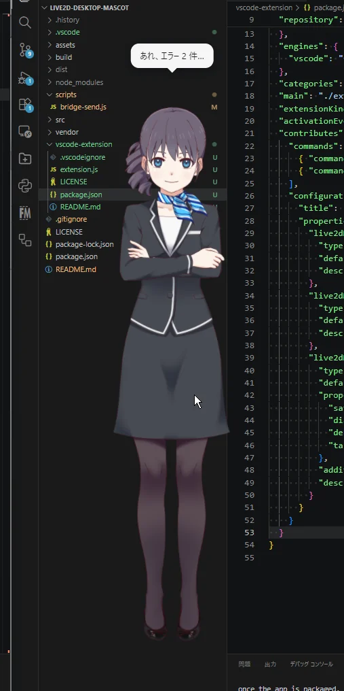
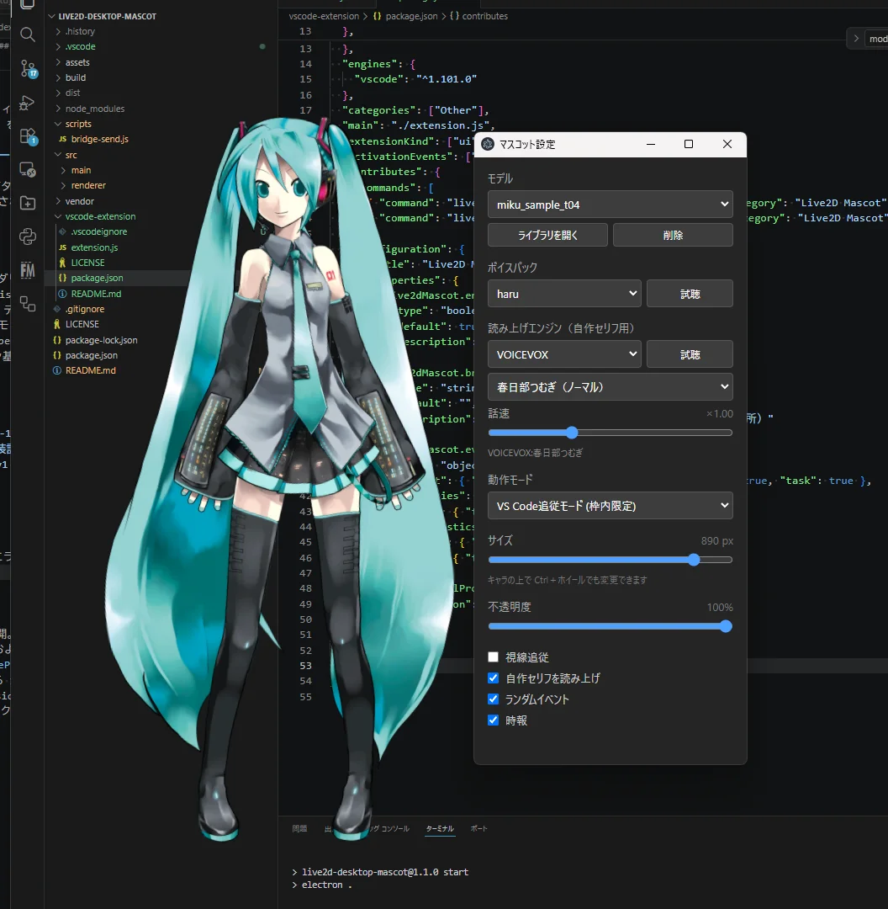

# Live2D Desktop Mascot — 한국어판 + Claude 에이전트

[fixtan/live2d-desktop-mascot](https://github.com/fixtan/live2d-desktop-mascot)(MIT) v1.5.0 을 한국어로 옮기고,
캐릭터에게 직접 일을 시킬 수 있는 **Claude 에이전트**를 붙인 버전입니다.

## Claude 에이전트

캐릭터를 **더블클릭**하거나 **⌘⇧Space**(Windows: Ctrl+Shift+Space)를 누르면 캐릭터 옆에 말 걸기 말풍선이 열립니다.

- 그냥 말 걸면 됩니다. 앱을 켠 뒤 첫 말에서 새 대화가 시작되고, 앱을 끌 때까지 이어집니다.
- 작업 폴더는 자동으로 `~/Claude작업` 을 씁니다. 바꾸려면 우클릭 → 🤖 Claude → 작업 폴더.
- 기본 모델은 **Haiku 5.5**(가볍고 빠름). 우클릭 → 🤖 Claude → 모델에서 Sonnet / Opus 로 바꿀 수 있습니다.
- 작업 폴더 안의 파일 만들기·고치기는 바로 하고, **명령 실행 등은 말풍선 안의 버튼으로 물어봅니다.**
- 입력칸은 캐릭터 발밑, 답변 말풍선은 머리 위에 뜹니다. 발밑에 자리가 없으면 말 거는 동안만 캐릭터가 살짝 올라갑니다.
- **캐릭터 말투(지침)**: 말풍선 위의 "말투" 버튼(또는 우클릭 → 🤖 Claude → 🗣 캐릭터 말투)에서 이름·말투·호칭·성격을 적어 두면 그 캐릭터로 대답합니다.
- Esc 로 닫기, 말풍선 위의 "지난 대화"로 이번 대화 기록 보기.
- **기억**: 대화가 끝나면(다음에 켤 때·새 대화 때) 중요한 정보와 최근 일만 짧게 압축해 기억합니다. "이거 기억해" 하면 바로 적습니다. 말풍선 위 "기억" 버튼으로 보고 고칠 수 있습니다.
- **알림**: "30분 뒤에 알려 줘", "매일 9시에 할 일 정리하라고 알려 줘"처럼 말하면 시간이 되면 캐릭터가 부르고 알림도 띄웁니다.
- **클립보드 번역·다듬기**: 글을 복사하고 ⌘⇧1(번역) / ⌘⇧2(다듬기). 결과는 말풍선에 뜨고 클립보드에도 들어갑니다.
- **파일**: 입력칸에 파일을 끌어다 놓으면 그 파일을 보고 도와줍니다.
- 아재개그는 우클릭 → 🤣 아재개그.

캐릭터는 작업 상태에 반응합니다. 반응 흐름과 혼잣말 규칙은 [deepseek-harness-kr](https://github.com/noire113-dev/deepseek-harness-kr)의 DeepSeek짱을 따랐습니다.

| 상태 | 반응 |
|---|---|
| 시작 | "알겠어요! 시작할게요" |
| 생각 중 | 추론 요약을 점선 말풍선 혼잣말로 (6초에 한 번 정도) |
| 도구 사용 | "파일 읽는 중…", "명령 실행 중…" 등 |
| 승인 대기 | "이 명령 실행해도 될까요?" + 당황/땀 표정 |
| 완료 / 실패 | "다 했어요!" + 답변 첫 문장 / "앗, 문제가 생겼어요…" |

- **표정은 모델에 맞춰 자동으로 고릅니다.** 모델의 표정 이름에서 heart·happy·smile(완료), sweat·surprised(승인 대기), tear·sad(실패), think(생각 중) 같은 낱말을 찾아 씁니다. 맞는 표정이 없으면 몸짓만 합니다. VRM 은 happy / surprised / sad / relaxed 를 씁니다.
- 말풍선 글자의 모음(한글 ㅏㅔㅣㅗㅜ…, 영어 a e i o u)에 맞춰 입을 움직입니다.

### 인증

- **Claude 계정(Pro/Max 구독) 로그인**을 씁니다. 로그인이 안 되어 있으면 말풍선에 **로그인 버튼**이 나오고, 누르면 브라우저에서 Claude 로그인 창이 열립니다. (우클릭 → 🤖 Claude → 🔑 Claude 계정 로그인)
- 이 로그인은 앱에 들어 있는 Claude Code 의 로그인과 같아서, 이미 Claude Code 를 쓰고 있다면 따로 할 일이 없습니다. Claude 데스크톱 앱의 로그인과는 별개입니다.
- 사용량은 그 구독의 한도 안에서 쓰입니다. 본인 컴퓨터에서 본인 계정으로 쓰는 개인 용도를 전제로 합니다.
- 환경 변수 `ANTHROPIC_API_KEY` 가 있으면 그걸 씁니다.

설정 파일: `~/Library/Application Support/live2d-desktop-mascot/agent.json` (macOS)

---

## 원본 README (일본어)

# Live2D Desktop Mascot

VS Code のウィンドウ内に常駐する Live2D / VRM デスクトップマスコット（Windows / macOS / Linux）。



- VS Code の枠内に留まる（キャラごとに切り替え。オフなら自由に動かせる）
- VS Code 拡張と連携して、保存・エラーの増減・デバッグ開始・タスクの成否に反応
- マウスを目で追う・クリック／ダブルクリックで反応・時報・独り言
- キャラ以外の透明部分はクリックが下のアプリに抜ける
- Live2D（Cubism 3 / 4）と VRM（0.x / 1.0）に対応
- 複数のキャラを同時に表示（Live2D と VRM を混ぜても可）。同時にはしゃべらず順番に話す
- モデル切り替え（ZIP／フォルダ／.vrm 取り込み、モデルファイル直接指定）。設定ではサムネ付きの一覧から選べる
- VRM は VRMA モーション（待機・しぐさ）を使える。待機モーション2種を同梱
- ボイスパック（声と字幕とモーションの組み合わせ）
- 声：ボイスパック／VOICEVOX（キャラごとに話者を選べる。ボイスパックのセリフも読む）／ OS 標準音声／ミュート
- 音量に合わせた口パク（Live2D・VRM とも）

## ダウンロード

[Releases](../../releases) から

- `live2d-desktop-mascot-x.x.x-setup.exe` … Windows インストーラー
- `live2d-desktop-mascot-x.x.x-portable.exe` … Windows インストール不要版

- `live2d-desktop-mascot-x.x.x-mac-arm64.dmg` … Mac（Apple Silicon）
- `live2d-desktop-mascot-x.x.x-mac-x64.dmg` … Mac（Intel）

- `live2d-desktop-mascot-x.x.x-linux-x86_64.AppImage` … Linux（どのディストリでも）
- `live2d-desktop-mascot-x.x.x-linux-amd64.deb` … Debian / Ubuntu

- `live2d-mascot-bridge-x.x.x.vsix` … VS Code 拡張（連携用。なくてもマスコット単体で動きます）

> **Windows**：署名していないため「Windows によって PC が保護されました」と表示されます。「詳細情報」→「実行」で起動できます。
>
> **macOS**：署名・公証していないため初回は開けません。「システム設定」→「プライバシーとセキュリティ」→「このまま開く」で起動できます。
> 「壊れているため開けません」と出る場合はターミナルで `xattr -cr "/Applications/Live2D Desktop Mascot.app"` を実行してください。
> macOS では VS Code 追従は使えません（自由に動かせます）。常駐アイコンはメニューバーに出ます。
>
> **Linux**：deb は `sudo apt install ./live2d-desktop-mascot-x.x.x-linux-amd64.deb`。
> AppImage は `chmod +x` してから実行してください（起動しない環境では `--no-sandbox` を付ける）。
> VS Code 追従は使えません（自由に動かせます）。
> GNOME ではトレイアイコンの表示に AppIndicator 拡張が必要です。Wayland ではウィンドウの位置や最前面表示が効かないことがあります。

### VS Code 拡張

`.vsix` を VS Code の拡張機能ビュー「…」→「VSIX からのインストール…」で入れるか、`code --install-extension live2d-mascot-bridge-x.x.x.vsix`。
マスコットが起動していれば自動でつながり、ステータスバーに `♡ Mascot` が出ます。WSL・リモート接続のウィンドウでも使えます。

## 使い方

| 操作 | 動作 |
|---|---|
| ドラッグ | 移動 |
| クリック | 反応（声・しぐさ） |
| ダブルクリック | 挨拶＋時刻 |
| Ctrl＋ホイール | サイズ変更 |
| 右クリック | そのキャラの設定（モデル・声・話者・視線追従・ランダムイベント・時報・VS Code 追従）、設定ウィンドウ、隠す、終了 |
| タスクトレイ | 表示／非表示・位置リセット・終了 |

設定は別ウィンドウで開きます（移動でき、位置は次回も同じ）。「見た目／声／ふるまい」はキャラごと、一番下の「全キャラ共通」はライブラリとモーションの置き場所です。

### 声

| 話し方 | クリック・ランダム（ボイスパックのセリフ） | ひとこと・時報・VS Code への反応 |
|---|---|---|
| ボイスパックだけ | ボイスパックの声 | 字幕だけ |
| VOICEVOX | そのキャラの話者で読む | そのキャラの話者で読む |
| ボイスパック＋OS 音声 | ボイスパックの声 | OS の読み上げ |
| ミュート | 字幕だけ | 字幕だけ |

VOICEVOX は起動していれば使います。起動していない時はボイスパックの声（自作セリフは OS の読み上げ）に戻ります。

### 複数キャラ

設定ウィンドウの一番上の「キャラ」欄の＋でキャラを追加、−で削除します。どのキャラの設定を表示するかもここで選びます。

- モデル・声・話者・ボイスパック・サイズ・VS Code 追従などはキャラごと。位置もキャラごとに覚えて、次の起動で同じ場所に出ます
- VS Code のイベントと時報には代表（1番目のキャラ）だけが反応します
- 同時にはしゃべりません。独り言・時報・VS Code への反応は、ほかのキャラが話し中なら見送り、クリックや「話しかける」は割り込みます
- モデルのライブラリ・モーションは全キャラ共通です
- トレイの「表示 / 非表示」「位置をリセット」は全キャラ、右クリックメニューの「隠す」はそのキャラだけに効きます
- 以前の版の設定は、最初の起動で1体目に引き継がれます

キャラ1体ごとに描画の負荷が増えます。GPU の無い環境では1体（Live2D、または軽い VRM）での利用をおすすめします。



モデルの ZIP・フォルダ・`.vrm` をキャラの上にドロップすると取り込んで、そのキャラに使います（設定の「取り込む…」でも同じ）。日本語のファイル名を含む ZIP（Windows で作ったもの・Mac で作ったもの）も取り込めます。
取り込んだモデルは設定フォルダ（下記）の `models/` に保存されます。同じ名前のモデルは上書きします。

### サムネ

設定ウィンドウのモデル一覧には、VRM に埋め込まれたサムネが出ます。無いモデル（Live2D など）は頭文字です。
ライブラリのモデルは、一覧のタイルに画像（PNG・JPEG・WebP）をドロップするとサムネを付けられます（`models/<名前>/thumb.*` に保存。埋め込みより優先、取り込み直しても残ります）。
VRM のサムネは [VRM Thumbnail Editor](https://lain-lab.com/featured/vrm-thumbnail-editor/) でも埋め込めます。

対応モデル：

| 形式 | ファイル | 取り込み |
|---|---|---|
| Live2D Cubism 3 / 4 | `.model3.json` | ZIP・フォルダ（`.model3.json` を直接ドロップすると取り込まずに参照） |
| VRM 0.x / 1.0 | `.vrm` | `.vrm` 単体・ZIP |

Cubism 5.3 以降の形式（moc3 ver 6）はまだ読めません。

### VRM のモーション（VRMA）

`.vrma` をキャラの上にドロップすると、設定フォルダの `motions/` に入ります（複数まとめて可）。`.vrma` だけを入れた ZIP をドロップするとまとめて取り込めます（同じ名前は上書き）。モーションは全 VRM モデル共通です。

- 名前が `idle` で始まるもの（`idle.vrma`・`idle2.vrma`・`idle_sit.vrma` …）… 待機。1本終わるたびにランダムに切り替わる
- それ以外 … しぐさ。クリック・独り言・ボイスパックの `motion`（ファイル名の部分一致）で使う

`motions/` に待機が1本も無い時は、同梱の待機モーション（Idle・Idle1）を使います。自分の待機を入れるとそちらに切り替わります。
モーションの前後左右の移動は無視してその場で動きます（上下は残る）。
VRMA が無くても、手を下ろした立ち姿・呼吸・まばたき・視線追従・簡単なしぐさで動きます。

VRM は Live2D より重く、GPU の無い環境（リモートデスクトップ・仮想マシン）では動きがかくつくことがあります。


## 開発

```
npm install          # three の一部ファイルを src/renderer/vendor/ にコピーする処理も走る
npm start            # 起動
npm start -- --devtools # DevTools付き
npm run dist:win     # Windows版ビルド（dist/）
npm run dist:mac     # macOS版ビルド（Mac上で実行）
npm run dist:linux   # Linux版ビルド（Linux上で実行）
```

リポジトリには Live2D の再配布物を含めていません。以下を各自で配置してください。

- `vendor/live2dcubismcore.min.js` … [vendor/README.md](vendor/README.md) 参照
- `assets/haru/` … [ハル](https://www.live2d.com/learn/sample/) の `runtime/` の中身
- `assets/haru_greeter/` … [ハル（受付）](https://www.live2d.com/learn/sample/) の `runtime/` の中身

### 構成

```
src/main/main.js            メインプロセス（キャラごとのウィンドウ・トレイ・IPC・話す順番）
src/main/characters.js      characters.json（キャラの一覧・キャラごとの設定と位置）
src/main/library.js         モデルライブラリ（取り込み・一覧・削除。同名は上書き）
src/main/thumbs.js          サムネ（thumb.* → VRM の埋め込み）
src/main/motions.js         VRMA モーションの置き場所（取り込み・一覧。同梱分と合わせる）
src/main/config.js          config.json の読み込み（既定値の補完）
src/main/bridge.js          WebSocket サーバー（VS Code 拡張との連携）
src/main/tracker/           VS Code位置追跡（OS別。現在 win32 のみ）
src/renderer/app.js         吹き出し・イベント・設定の反映・入力・音声
src/renderer/settings.*     設定ウィンドウ（操作を送り、状態を受け取って表示するだけ）
src/renderer/adapters/      描画アダプタ（live2d.js：PixiJS、vrm.js：three.js。同じメソッドを持つ）
src/shared/formats.js       対応するモデル形式の一覧（形式を増やす時はここに足してアダプタを置く）
src/shared/motions.js       モーションの役割（待機・しぐさ）の決め方
scripts/copy-three-addons.js three の GLTFLoader などを vendor/ にコピー（ビルドに examples が入らないため）
assets/<モデル>/            同梱モデル
assets/motions/             同梱の VRMA（待機）
assets/voices/<名前>/       ボイスパック
vendor/                     Cubism Core
scripts/bridge-send.js      連携のテスト送信
docs/                       README 用の画像
vscode-extension/           VS Code 拡張（Live2D Mascot Bridge）
```

### ボイスパック

`assets/voices/<名前>/voices.json`

```json
{
  "voices": [
    { "file": "../../haru/sounds/haru_normal_01.wav", "text": "お疲れ様です", "motion": "haru_normal_01", "on": ["idle"] }
  ]
}
```

- `file`: voices.json からの相対パス
- `text`: 吹き出しの字幕（空なら出さない）
- `motion`: モーションファイル名の部分一致（無ければランダム）
- `on`: 使う場面（`click` / `idle`、連携イベントは下記。省略で click / idle の全場面）

### VS Code 連携（WebSocket）

VS Code 拡張などから、保存・エラー・タスク結果などのイベントを受け取って反応します。
VS Code 側の拡張は [vscode-extension/](vscode-extension/) にあります。

設定フォルダ（トレイの「📂 設定フォルダを開く」）

| OS | 場所 |
|---|---|
| Windows | `%APPDATA%\Live2D Desktop Mascot\` |
| macOS | `~/Library/Application Support/Live2D Desktop Mascot/` |
| Linux | `~/.config/Live2D Desktop Mascot/` |

- `characters.json`：キャラの一覧とキャラごとの設定・位置。アプリが書く（手で編集する場合は終了してから）
- `config.json`：ユーザーが編集する設定。変更は再起動で反映
  ```json
  { "configVersion": 1, "bridge": { "enabled": true, "port": 0 } }
  ```
  `port` が `0` なら空きポートを自動で使う。番号を書くとそのポートを使う（使用中なら自動に切り替え）
- `bridge.json`：起動時にアプリが書き出す接続情報。終了時に削除される。クライアントはこれを読む
  ```json
  { "v": 1, "host": "127.0.0.1", "port": 53811, "token": "…", "pid": 1234, "version": "1.2.0" }
  ```

接続：`ws://127.0.0.1:<port>/?token=<token>`。127.0.0.1 のみで待ち受け、Origin ヘッダー付き（ブラウザ）の接続は拒否します。接続すると `welcome` が返ります。

メッセージ：`{ "v": 1, "type": "...", "payload": { ... }, "ts": 1759110000000 }`

| type | payload | 反応 |
|---|---|---|
| `save` | `{ file?, languageId? }` | ときどき（最短45秒おき） |
| `diagnostics` | `{ errors, warnings }` | エラーが増えた時・0件になった時。変化のたびに送ってよい（接続直後の1回目は基準値として扱う） |
| `debugStart` | `{ name? }` | デバッグ開始 |
| `taskEnd` | `{ name, exitCode }` | 成功／失敗（`exitCode` が無ければ無反応） |
| `say` | `{ text }` | そのまましゃべる（200文字まで） |
| `ping` | — | `pong` を返す |

キャラが複数いる時は、代表（1番目）のキャラが反応します。

ボイスパックの `on` に `save` / `error` / `fixed` / `debug` / `taskOk` / `taskFail` / `connect` を書くと、その場面ではセリフの代わりにその声を使います。

テスト送信：

```
node scripts/bridge-send.js say テストだよ
node scripts/bridge-send.js diagnostics errors=0 errors=3 errors=0
node scripts/bridge-send.js taskEnd name=build,exitCode=1
```

## クレジット

- Live2D Cubism Core — © Live2D Inc.（Live2D Proprietary Software License）
- 同梱モデル・音声「ハル」— Live2D Inc. サンプルデータ
- 同梱モーション「Idle」「Idle1」— lain（本リポジトリと同じ MIT License）
- Electron / PixiJS / pixi-live2d-display / three.js / @pixiv/three-vrm / @pixiv/three-vrm-animation / adm-zip / ws — MIT License
- VRM モデルは同梱していません。各モデルの利用条件に従って使ってください。
- VOICEVOX は同梱していません。音声を公開する場合は「VOICEVOX:キャラ名」の表記が必要です。
